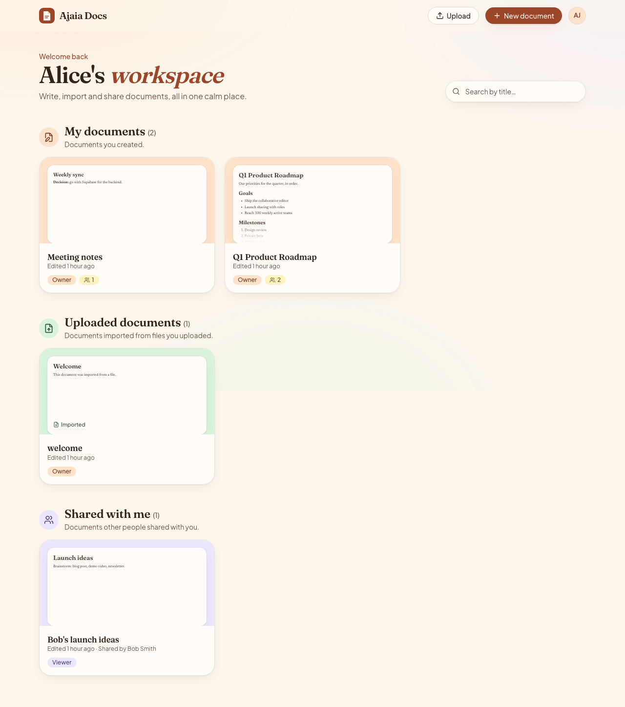
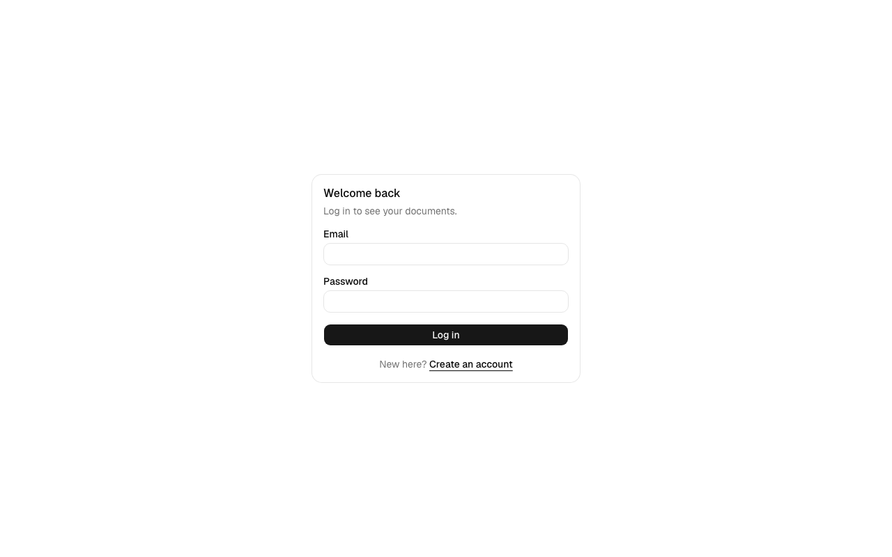
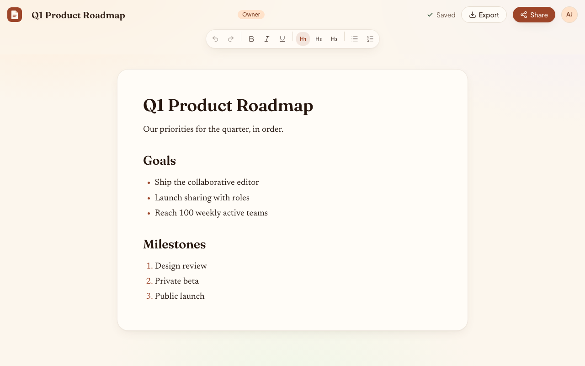
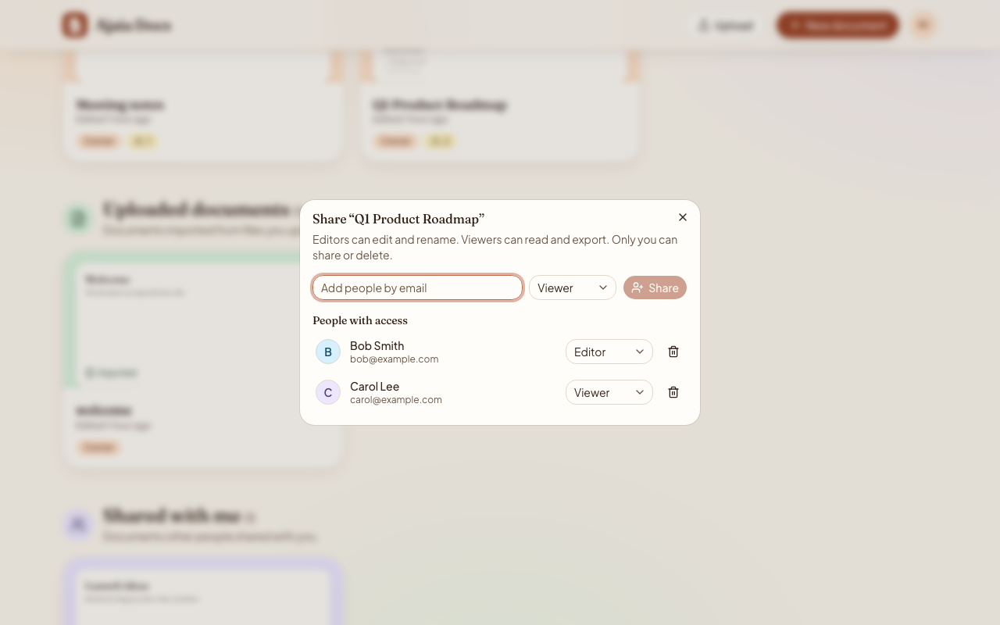
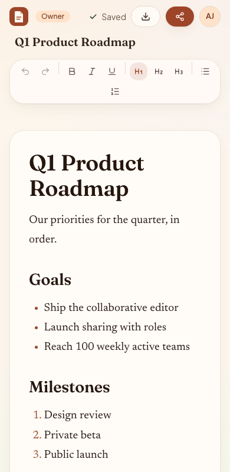

# Ajaia Docs — a lightweight collaborative document editor

A small full-stack, Google-Docs-inspired editor: create and edit rich-text documents, import files, share with other people using roles, and export to Markdown or PDF.

**Live app:** https://mock-doc.vercel.app

| Demo account | Password | Notes |
|---|---|---|
| `alice@example.com` | `Demo-pass-123` | Owns the sample documents |
| `bob@example.com` | `Demo-pass-123` | **Editor** on Alice's *Q1 Product Roadmap*, **viewer** on *Meeting notes* |
| `carol@example.com` | `Demo-pass-123` | **Viewer** on *Q1 Product Roadmap* |

You can also create your own account at `/signup` (no email confirmation needed). On the login page, the **Alice / Bob / Carol** buttons log you in with one click.

> **Quick sharing demo:** open two browsers (or one normal + one private window), log in as Alice in one and Bob in the other. Alice: open *Q1 Product Roadmap* → **Share** → change Bob's role or remove him. Bob: refresh to see the change.



| | |
|---|---|
|  |  |
|  |  |

## What it does

| Area | Features |
|---|---|
| **Documents** | Create, rename, delete (owner only), reopen after refresh. Autosave with a Saving / Saved / Not saved + Retry indicator, Ctrl/Cmd+S, and a warning if you close the tab with unsaved changes. |
| **Rich text** | Bold, italic, underline, headings (H1–H3), bulleted and numbered lists, undo/redo, keyboard shortcuts. Content is stored as structured JSON so formatting survives reloads. |
| **Dashboard** | One page with three sections: **My documents**, **Uploaded documents**, **Shared with me**. Title search. Owned vs. shared is clear at a glance (section, role badge, "Shared by …", accent border, share count). |
| **File upload** | Turns a file into a **new editable document**. Supported: **`.txt`, `.md`, `.docx`**, up to **4 MB**. Headings, bold, italic, underline and lists are kept; images and tables are not imported. This is stated in the upload dialog. |
| **Sharing & roles** | Owner shares by email as **Editor** or **Viewer**; owner can change roles or revoke at any time. Editors can edit and rename; viewers are read-only; only the owner can share or delete. Enforced in the database (RLS), not just the UI. |
| **Export** *(stretch)* | **Markdown** (`.md` download) and **PDF** (browser print dialog → "Save as PDF", with a print stylesheet that hides the app chrome). Available to every role, from the editor or the dashboard card menu. |
| **Design** | A warm pastel design system (cream, peach, sage, lavender) with a typographic pairing of Fraunces (display), Plus Jakarta Sans (UI) and Newsreader (document body). Document **thumbnails** on the dashboard, a glass navbar, and Framer Motion micro-interactions (staggered cards, hover lift, animated save status, animated dialogs); `prefers-reduced-motion` is respected. Login/signup are a split-screen with one-click **demo accounts**. |
| **Quality** | Input validation (zod) on client and server, friendly error states, accessibility scans (axe) on every screen, responsive layout, 59 automated tests. |

## Tech stack

Next.js 16 (App Router, Server Actions) · TypeScript · Tailwind + shadcn/ui · Framer Motion · Tiptap editor · Supabase (Auth, Postgres + Row Level Security) · Vercel · Vitest + Playwright.

See [ARCHITECTURE.md](ARCHITECTURE.md) for design decisions and trade-offs.

## Run it locally

**Prerequisites:** Node.js ≥ 20.12, npm, and a free [Supabase](https://supabase.com) project. (Docker is *not* needed.)

### 1. Install

```bash
git clone https://github.com/lasyagowda07/mock-doc.git && cd mock-doc
npm install
```

### 2. Create the Supabase project

1. Create a project at supabase.com (free tier).
2. **Authentication → Providers → Email:** turn **off** "Confirm email" (so sign-ups work instantly without sending email).
3. Collect the values from **Project Settings → API** (URL, publishable/anon key, secret/service-role key) and **Project Settings → Database** (password, and the **session pooler** connection string from the *Connect* dialog).

### 3. Configure environment variables

```bash
cp .env.example .env.local   # then fill it in
```

| Variable | Where it comes from | Used for |
|---|---|---|
| `NEXT_PUBLIC_SUPABASE_URL` | Project Settings → API | Browser + server Supabase client |
| `NEXT_PUBLIC_SUPABASE_ANON_KEY` | Publishable (anon) key | Browser + server Supabase client (safe to expose; protected by RLS) |
| `SUPABASE_SERVICE_ROLE_KEY` | Secret (service-role) key | **Server/scripts only**: seed script and tests. Never sent to the browser. |
| `SUPABASE_DB_URL` | *Connect → Session pooler* string | `npm run db:push` (applies migrations). The direct `db.<ref>.supabase.co` host is IPv6-only, so use the pooler. |
| `SUPABASE_DB_PASSWORD` | Project Settings → Database | Reference only |

No secrets are committed; `.env.local` is git-ignored.

### 4. Create the database schema

```bash
npm run db:push
```

This applies the SQL files in [`supabase/migrations`](supabase/migrations) using the Supabase CLI (installed on demand: `brew install supabase/tap/supabase`, or see the Supabase docs).
**No CLI?** Open the Supabase dashboard → **SQL Editor**, then paste and run the three migration files **in order** (`…_init.sql`, `…_fix_select_policy.sql`, then `…_document_preview.sql`).

### 5. Seed demo data

```bash
npm run seed
```

Creates Alice, Bob and Carol (password `Demo-pass-123`), sample documents and shares. Safe to re-run.

### 6. Start

```bash
npm run dev      # http://localhost:3000
```

## Tests

```bash
npm test             # 40 unit + database tests (Vitest)
npm run typecheck && npm run lint
npm run test:e2e     # 19 browser tests (Playwright); starts the dev server itself
```

One-time browser install for E2E: `npx playwright install chromium`.
Run E2E against the deployed site with `E2E_BASE_URL=https://mock-doc.vercel.app npm run test:e2e`.

What the tests cover:
- **`tests/rls.test.ts`** — runs against the real Supabase project with throwaway users: strangers can't read, viewers can't write, editors can't change ownership or manage shares, only owners delete, revoked access takes effect immediately.
- **`tests/preview.test.ts`** — the database trigger that derives dashboard thumbnails: capped to the first blocks, follows edits, can't be forged by a client, falls back to an excerpt for huge blocks.
- **`tests/import.test.ts`, `tests/export.test.ts`** — txt/md/docx conversion (including a real `.docx` generated in the test), XSS stripping, bad-file rejection, Markdown serialization and a round trip.
- **`tests/e2e/*`** — the full user journeys in a real browser: auth, CRUD + formatting persistence, upload, two-user sharing lifecycle (viewer → editor → revoked, including mid-edit), export downloads, offline autosave recovery, axe accessibility scans, and zero console errors.

## Deploy (Vercel)

1. Push the repo to GitHub and import it in Vercel (framework preset: Next.js).
2. Add the three variables `NEXT_PUBLIC_SUPABASE_URL`, `NEXT_PUBLIC_SUPABASE_ANON_KEY`, `SUPABASE_SERVICE_ROLE_KEY` to the project's environment variables.
3. Deploy. Every push to `main` redeploys automatically.

Nothing else is required: no email provider, no paid services.

## Status

**Working end to end:** everything in the table above, locally and on the live deployment (verified with the E2E suite against production).

**Partially done / intentionally limited**
- **Concurrent editing is last-write-wins.** If two people edit the same document at the same moment, the later save overwrites the earlier one. There are no live cursors or merging.
- **PDF export uses the browser print dialog** (best text quality and full Unicode, but it's one extra click compared to a direct download).
- **Upload fidelity:** only text, headings, bold/italic/underline and lists are imported; images, tables and `.docx` comments are dropped. One file at a time, 4 MB max.
- **Sharing requires the recipient to have an account already** (no email invitations).
- Dark mode is intentionally off; the UI is light-only.

**With another 2–4 hours I would build**
1. Real-time collaboration (Supabase Realtime + Yjs/Tiptap collaboration) with presence indicators — the biggest gap vs. Google Docs.
2. Version history (store snapshots on save; list and restore).
3. Email invitations for people without an account, plus a "copy link" with viewer access.
4. Image and table support in the editor, and `.docx` export.
5. Live dashboard updates when something is shared with you.

## Project layout

```
src/app/            routes: dashboard, /docs/[id], auth pages, server actions
src/components/     UI (shadcn in components/ui), editor + autosave, dialogs
src/lib/            supabase clients, validation (zod), import/export, permissions
supabase/migrations SQL schema + RLS policies (source of truth)
scripts/seed.mjs    demo users/documents
tests/              unit, database (RLS) and e2e tests
docs/screenshots    screenshots used in the docs
```

## Documents in this repo

- [ARCHITECTURE.md](ARCHITECTURE.md) — what was prioritized and why
- [AI_WORKFLOW.md](AI_WORKFLOW.md) — how AI tools were used and verified
- [SUBMISSION.md](SUBMISSION.md) — exactly what's included in the submission
- Walkthrough video: https://youtu.be/OrKCvrkOF3g
